 

  

###

<h1 align="center">Привет, меня зовут Альберт!</h1>

<h3 align="left">Обо мне</h3>

Я студент 4 курса по специальности «Информационные системы и программирование». Пишу софт для автоматизации игровых процессов и ботов. Сейчас изучаю разработку ПО и углубляю свои навыки в программировании.

<h1></h1>

  

<table align="center" width="100%" border="0" style="border: none; background: transparent;">
  <!-- Верхний ряд: 2 симметричные колонки -->
  <tr style="border: none;">
    <td align="center" valign="top" width="50%" style="border: none; padding: 15px;">
      
<b>Языки программирования</b>

      

        
      
<b>Веб-технологии и форматы</b>

      

    </td>
    <td align="center" valign="top" width="50%" style="border: none; padding: 15px;">
      
<b>IDE и экосистема</b>

      

        
      
<b>ОС и терминал</b>

      

    </td>
  </tr>
  <!-- Нижний ряд: Базы данных ровно по центру на всю ширину -->
  <tr style="border: none;">
    <td align="center" colspan="2" style="border: none; padding-top: 15px;">
      
<b>Базы данных</b>

      

    </td>
  </tr>
</table>

